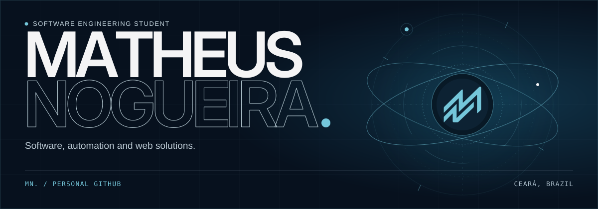

[Portfolio](https://mathsns.github.io/matheus-portfolio/) · [LinkedIn](https://www.linkedin.com/in/matheus-nogueira1)

I'm a Software Engineering student at [UFCA](https://www.ufca.edu.br/), based in Ceará, Brazil. I build APIs, automate workflows and explore how AI can make software more useful.

Currently an IT intern at [Unimed Cariri](https://www.unimedcariri.com.br/) and president of [Calang.io](https://www.calangio.com.br/pt).

## Selected work

- **Minerva** · A living knowledge platform in development, exploring document intelligence, RAG and traceable knowledge workflows. `In development`
- **[EcoTech](https://github.com/mathsNS/Ecotech)** · A collaborative electronic waste management platform, with layered architecture, domain modeling and automated tests.
- **[Personal portfolio](https://mathsns.github.io/matheus-portfolio/)** · My work, experiments and professional journey, built with React and TypeScript. [Source code](https://github.com/mathsNS/matheus-portfolio).
- **[V.I.T.A.](https://github.com/mathsNS/V.I.T.A)** · A high-fidelity healthcare pre-triage prototype focused on requirements engineering and user experience.

## What I work with

- **Backend & data:** Python, FastAPI, SQLAlchemy, Oracle, SQL, PL/SQL
- **Web:** TypeScript, React, Next.js, Vite
- **Automation & quality:** Selenium, Pytest, Docker, GitHub Actions
- **Exploring:** RAG, AI evaluation, software architecture and system design
